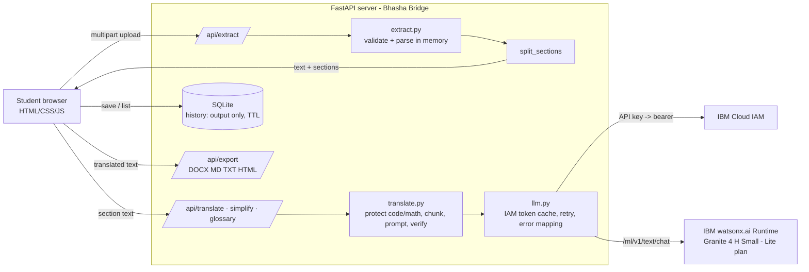

# Architecture & data flow

**Translate flow:** upload → `extract_document` (type sniffing, limits, Markdown output) → sections → per section: `protect()` swaps code/math/URLs for `⟦P#⟧` → chunks ≤2500 chars → Granite chat call (system prompt with preservation rules) → `restore()`; if placeholders are missing, retry once, else re-append and warn → numeric check → ordered reassembly → UI (side by side) → optional history save (output only) → export.

**Trust boundaries:** browser never sees IBM credentials; documents live only in request memory and browser state; only translated output is persisted (SQLite, auto-expiring).

**Demo mode:** if `WATSONX_API_KEY`/`WATSONX_PROJECT_ID` are absent (or `DEMO_MODE=true`) the client never calls IBM; responses carry `provider:"demo"` and a visible banner.
